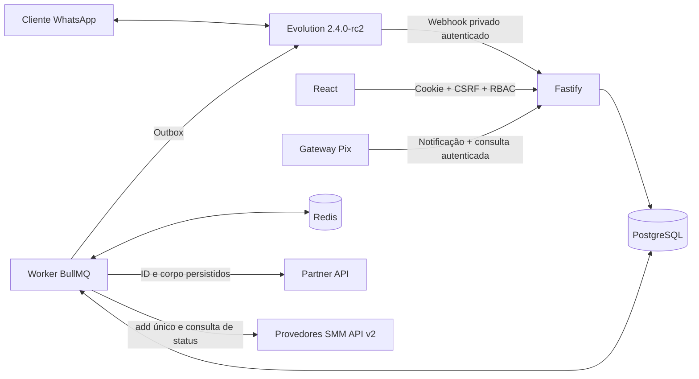
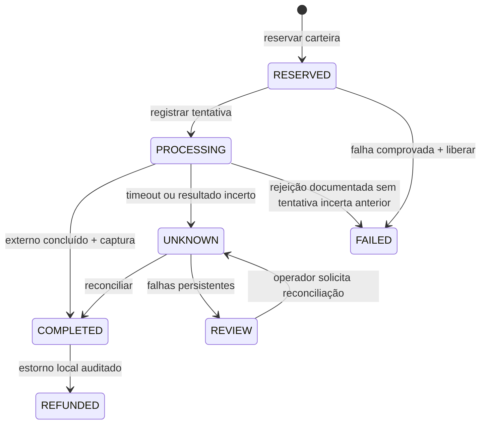

# Arquitetura e invariantes

## Componentes

Backend Fastify e worker BullMQ são processos independentes. PostgreSQL é a fonte de verdade para conversas, ledger, pedidos, cobranças e outbox de mensagens. Redis suporta locks, rate limiting compartilhado, cache de catálogo e filas. Um pump recupera eventos, compras e envios persistidos após reinício, sem depender de uma transação distribuída PostgreSQL/Redis.

Eventos que esgotam retentativas entram em revisão, com código seguro e contador persistidos. O proprietário pode reprocessá-los em Logs → Eventos em revisão; a ação é auditada. Pedidos em REVIEW também interrompem tentativas automáticas até reconciliação solicitada pelo operador.

O proxy publica somente o painel, `/api`, health checks e webhook Pix. O webhook Evolution usa a rede Docker interna e um header secreto. PostgreSQL/Redis/Evolution não publicam portas. App e Evolution possuem usuários e bancos PostgreSQL distintos; Redis separa aplicação em DB 0 e Evolution em DB 1. O plano de teste usa DB 15.

## Finanças

Valores monetários usam PostgreSQL `numeric`, Prisma Decimal e decimal.js. Preço é custo USD × cotação × (1 + markup/100) + margem fixa, salvo preço manual. Promoção válida pode reduzir o preço. Desconto local por volume é aplicado depois. O preço unitário é arredondado **para cima** no passo configurado, depois formatado em centavos (`ROUND_HALF_UP`). Custo de volume upstream considera o melhor preço entre `yourPrice` e faixas aplicáveis. Não há inferência de outros descontos não documentados.

Cada pedido persiste cotação, referência à taxa, custo estimado, preço unitário, quantidade e corpo externo. Quando confirmado, o custo realmente cobrado em USD determina o lucro bruto realizado. Esse lucro não desconta taxas Pix, impostos, despesas operacionais ou spread de financiamento do fornecedor; não representa lucro líquido. Estorno de pedido concluído credita a carteira e registra o custo externo como perda bruta.

Para SMM, o preço é por 1.000 unidades ou por pacote, multiplicado pela quantidade antes do arredondamento do total. Custos em BRL não possuem referência de cotação USD; custos USD congelam a taxa usada. O destino e os campos específicos ficam criptografados, e a impressão digital dos dados protege a confirmação idempotente. Pedidos/serviços possuem identificação por provedor, separada dos códigos Partner. Conclusões parciais conciliam a reserva com captura e devolução proporcionais, sem crédito duplicado. O [guia SMM](SMM.md) descreve as regras e os tipos compatíveis.

Como o contrato SMM API v2 não oferece idempotência de criação, uma tentativa `add` é registrada sob bloqueio antes do envio. Resposta perdida leva a revisão, conservando a reserva sem repetir a compra. O proprietário vincula um pedido externo existente após conferir os dados, ou confirma a ausência para liberar a reserva; ambas as ações são auditadas. Categorias da loja são independentes do provedor e do tipo de entrega. A migration 006 mantém as categorias equivalentes dos produtos Partner existentes.

Ledger é append-only. Constraints recusam saldos negativos e triggers proíbem alteração/exclusão de lançamentos e auditoria. Uma transação serializável com `FOR UPDATE` altera carteira e registra o lançamento. Chaves únicas evitam depósito/reserva/captura/estorno duplicado. Conflitos serializáveis são repetidos com backoff limitado.

Resultado desconhecido nunca libera ou captura a reserva por suposição. A reconciliação consulta `GET /orders?externalOrderId=...`. Se houver pedido simples, busca detalhe; lotes são recuperados pelo **mesmo POST**, pois o HTML informa que GET de detalhe não inclui `lines[]`. Se a busca não localizar o pedido, o contrato autoriza repetir com o mesmo ID e corpo. IDs, corpo e snapshots financeiros são protegidos por triggers.

## Pagamento e entrega

Pix usa a interface `PixGateway`, com Expay Brasil pela API atual e Mercado Pago por compatibilidade. `disabled` recusa cobranças. O ID local é a referência externa, e o corpo é persistido antes da primeira chamada. Retentativas preservam a chave de idempotência. A Expay usa X-API-Key e Idempotency-Key; callbacks apenas acionam consulta autenticada. Crédito exige GET ao gateway, UUID/referência/valor/moeda/meio corretos e status confirmado. O vencimento vem do provedor. Indicador explícito de pagamento de teste é recusado em produção; a Expay não documenta esse indicador no contrato atual. Reversão de depósito já creditado bloqueia a conta e encaminha o caso à revisão; não gera saldo negativo automaticamente.

Credenciais e textos ficam cifrados com AES-256-GCM; a chave mestra fica fora do banco. Cada linha gera uma entrega e uma mensagem de outbox. Após enviar, a resposta com ID técnico é registrada. **Evolution não documenta chave idempotente de envio**: timeout ou queda após enviar produz `UNKNOWN` e exige operador, sem retentativa automática. Não se promete entrega exatamente uma vez através da rede WhatsApp. Botão de reenvio não permite trocar destinatário e exige justificativa. Conteúdo protegido não é exibido no detalhe de pedidos.

Conversas usam menus numéricos, navegação por fornecedor/produto, paginação de produtos, timeout de 30 minutos e confirmação com resumo válido por 5 minutos. Quantidade e estoque são conferidos no momento do resumo e confirmação. `externalOrderId` deriva do UUID local. Receber `Suporte` pausa automação por até 24 horas; atendentes podem liberar antes. Uma instância pode ser pausada pelo painel. Respostas interativas recebidas são extraídas quando presentes; mensagens de saída usam o fallback numérico.

## Limites e privacidade

Limite upstream usa janela deslizante atômica Redis, compartilhada entre processos e segregada por hash da chave. Defaults: 60 consultas/min e 10 POST/min. Configure seu plano real; headers menores, quando presentes, reduzem caps. `Retry-After` em 429 ativa cooldown. GET tem recuperação limitada; POST não é repetido silenciosamente pelo transporte.

RBAC está em código: OWNER configura e opera finanças; OPERATOR atende e reconcilia; VIEWER consulta relatórios. Sessões de 8 horas têm token aleatório cujo hash fica no banco, cookies HttpOnly/Secure/SameSite e CSRF nas mutações. Logs de API guardam rota, código, requestId e duração, sem corpo/credenciais. Logs de requisições automáticos são desativados.

Mensagens recebidas iniciam a conversa e registram a data de contato. Não há módulo de disparo comercial ou lista de transmissão. O operador é responsável pela base legal, consentimento aplicável, política de privacidade, procedência dos produtos e atendimento de direitos LGPD. Histórico contém dados pessoais cifrados; consultas de mensagens são auditadas. Retenção operacional automática de logs/eventos é 30 dias. Retenção financeira e exclusão/anônimização de clientes exigem política específica da operação e revisão jurídica; não há exclusão irrestrita de ledger pelo painel.
